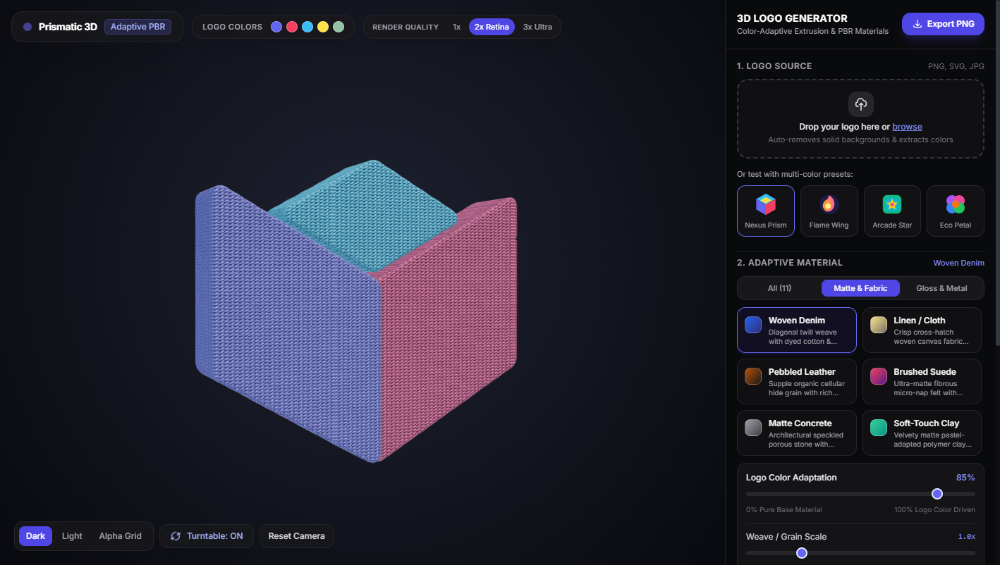

# Third-Dimension (3D Logo Material Studio)

<div align="center">



[](https://threejs.org/)
[](https://tailwindcss.com/)
[](LICENSE)
[](index.html)

**Turn any 2D logo (PNG, SVG, JPG, WebP) into tactile, color-adaptive 3D vector extrusions with physically based rendering (PBR) and 1024×1024 procedural micro-textures.**

[Live Demo](#quick-start) • [Features](#key-features) • [Architecture](#architecture--how-it-works) • [Material Library](#material-presets) • [Drafts & History](drafts/)

</div>

---

## Highlights

- **Sub-Pixel SDF Vector Extrusion**: Extracts smooth, mathematically continuous vector contours via separable Gaussian-blurred Signed Distance Fields (SDF) and directed Marching Squares—eliminating pixelated voxel stepping.
- **Laplacian & Chaikin Curve Smoothing**: Polishes outer boundaries and inner holes with Taubin zero-shrinkage Laplacian filtering followed by Chaikin subdivision.
- **1024×1024 Procedural Micro-Textures**: Synthesizes custom 24-bit tangent-space normal maps on the fly (Woven Denim, Linen Cloth, Pebbled Leather, Brushed Suede, and Porous Concrete) with trilinear mipmapping and 16× anisotropic filtering.
- **Triplanar UV Projection**: Uniformly maps micro-relief onto bevel chamfers and extruded walls with zero texture stretching or seam distortions.
- **Color-Adaptive PBR Shading**: Extracted logo palettes dynamically drive albedo, subsurface scatter, metallicity, and roughness across 11 physical materials.
- **Retina SSAA & Alpha Export**: Toggle between 1×, 2× Retina, and 3× Ultra super-sampling; export production-ready PNG snapshots with full alpha transparency.

---

## Key Features

### 1. Vector Logo Ingestion & Color Segmentation
- Drag-and-drop or file upload supporting `PNG`, `SVG`, `JPEG`, and `WebP`.
- Automatic solid-background keying from border sample heuristics.
- Greedy Euclidean distance clustering in 16-level RGB color space, extracting up to 6 dominant brand color clusters.

### 2. Dual Geometry Modes
- **Smooth Vector Extrude**: Clean, chamfered 3D solid meshes extruded from sub-pixel vector contours.
- **Layered SDF Relief**: Tiered sculptural mode that generates elevated inner crest contours for multi-depth physical badges and emblems.

### 3. Adaptive Material Presets
| Category | Preset | Description |
| :--- | :--- | :--- |
| **Matte & Fabric** | **Woven Denim** | 2/1 diagonal twill weave with warp/weft slub noise & indigo/cotton contrast |
| | **Linen / Cloth** | Orthogonal slub weave with soft matte scatter |
| | **Pebbled Leather** | Organic cellular Voronoi hide with supple satin-matte sheen |
| | **Brushed Suede** | Fibrous micro-nap felt with velvety rim scatter |
| | **Matte Concrete** | Architectural speckled porous stone with mineral grit |
| | **Soft-Touch Clay** | Velvety pastel-adapted polymer clay finish |
| **Gloss & Metal** | **Anodized Metal** | Brushed metallic sheen tinted by extracted logo hues |
| | **Frosted Glass** | Translucent refractive acrylic with colored transmission |
| | **Glossy Ceramic** | High-gloss porcelain with rich clearcoat glaze |
| | **Cyber Neon** | Luminous emissive core driven by logo saturation |
| | **Luxe Gold & Chrome**| Maps logo luminance into 24k gold, rose gold, and platinum foil |

### 4. Studio Lighting Environments
- **Studio Softbox**: Balanced photographic softbox rig with cool fill and specular highlights.
- **Warm Sunset**: High-angle golden key light with amber fill and lavender rim lights.
- **Cyberpunk Rim**: High-contrast split lighting with cyan key and neon magenta rim.
- **High-Contrast Noir**: Dramatic single-source directional key with deep shadows.

---

## Quick Start

No build tools, Node dependencies, or server setup required!

1. Clone this repository:
   ```bash
   git clone https://github.com/KetineniRamarao/Third-Dimension.git
   cd Third-Dimension
   ```
2. Open `index.html` in any modern web browser:
   - Double-click `index.html`, or
   - Serve locally:
     ```bash
     npx serve .
     # or
     python -m http.server 8080
     ```

---

## Architecture & How It Works

```
2D Logo (PNG/SVG/JPG)
         │
         ▼
[Corner Background Keying]
         │
         ▼
[Perceptual RGB Histogram Clustering] ──► Extracted Brand Color Palette
         │
         ▼
[Continuous Gaussian SDF Field]
         │
         ▼
[Sub-Pixel Marching Squares Iso-Contours]
         │
         ▼
[Laplacian Anti-Shrink + Chaikin Smoothing]
         │
         ▼
[Shoelace Area + Point-In-Polygon Hole Hierarchy]
         │
         ▼
[THREE.ExtrudeGeometry + Triplanar UV Projection]
         │
         ▼
[Procedural 1024x1024 Tangent-Space Normal Maps + PBR Shader]
         │
         ▼
Interactive 3D Viewport (OrbitControls / ACES Filmic / SSAA)
```

For in-depth mathematical documentation on the marching squares and normal map synthesis pipelines, see [`drafts/ARCHITECTURE_NOTES.md`](drafts/ARCHITECTURE_NOTES.md).

---

## Viewport Controls

- **Orbit**: Left Click + Drag
- **Zoom**: Mouse Wheel / Pinch
- **Pan**: Right Click + Drag
- **Turntable**: Toggle automatic rotation in the lower-left toolbar
- **Camera Reset**: Tap "Reset Camera" to return to original focus

---

## Repository Structure

```
Third-Dimension/
├── index.html                   # Production-ready single-file web studio
├── README.md                    # Project documentation
├── LICENSE                      # MIT License
├── .gitignore                   # Standard Git ignore rules
├── assets/
│   └── preview.png              # High-resolution render preview
└── drafts/
    ├── 3d_logo_material_studio.v1.html  # Original initial draft archive
    └── ARCHITECTURE_NOTES.md            # Technical engineering notes
```

---

## License

This project is licensed under the [MIT License](LICENSE).
